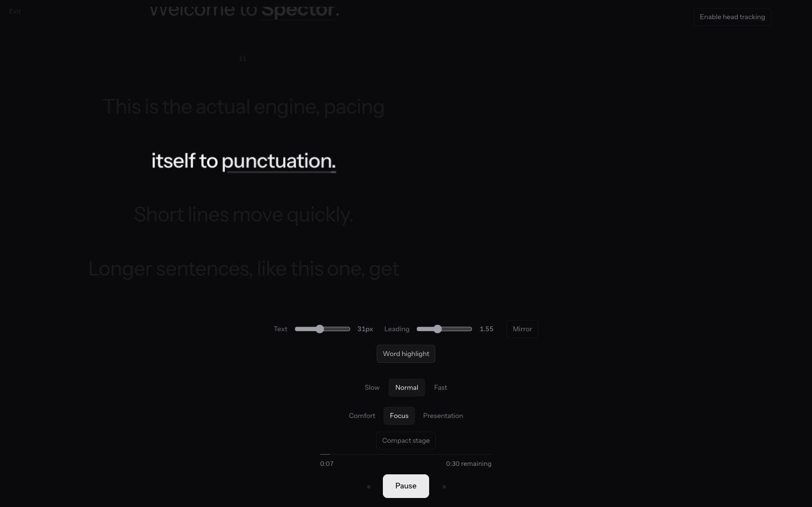
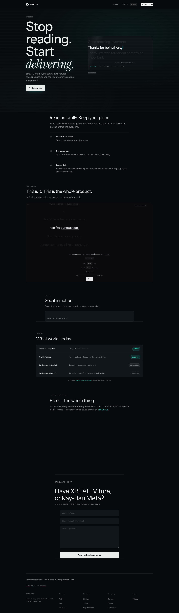

# Spector — Talk to camera. Not to your notes.

Auto-paced, comfort-tuned teleprompter for smart glasses and serious rehearsal.
**Free and open source. No account, no cloud, nothing uploaded — ever.**

[](https://spectorlabs.io)
[](LICENSE)
[](https://spectorlabs.io)
[](public/)

[](https://spectorlabs.io/app.html)

*The actual player, mid-rehearsal — dimmed context, one active line, `**emphasis**` earning a longer hold. [Try it live](https://spectorlabs.io), no sign-up.*

Spector is a free, open-source teleprompter PWA built by one person for the
smart-glasses era. Rehearse on your phone with adaptive, punctuation-aware
pacing, then perform eyes-up on whatever glasses you have — it's cross-brand
by design, not locked to any manufacturer.

> Not affiliated with Meta, Ray-Ban, or any glasses manufacturer. Works with any smart-glasses workflow.

---

## Try it

Open **https://spectorlabs.io** — that's the whole install.

1. Paste text, drop a `.txt` or `.md` (formatting stripped, Spector cues preserved), or load a sample
2. Check the live duration estimate ("≈4:32 at Normal") — it uses the real pacing engine
3. Open the player and pick a mode (try **Comfort**), speed, and text size
4. Tap Play (or press Space) — the engine paces itself to your punctuation, with word-level highlight tracking along
5. When done, review your pacing, hesitations, and slowest chunk on the end screen

Keyboard: `Space`/`K` play/pause, `R` rewind 3 chunks. Tap anywhere outside the controls to toggle playback. Install as a PWA (via the install hint on the landing, or your browser menu) for full offline use.

[](https://spectorlabs.io)

---

## Self-host it

Spector is a static site with **zero runtime dependencies** — the whole app
is [`public/`](public/). If you can serve files, you can host Spector:

```bash
git clone https://github.com/hydrogenbondss/SPECTOR.git
cd SPECTOR
python3 -m http.server 8000 --directory public
# open http://localhost:8000
```

Any static host works: GitHub Pages, Netlify, Vercel, Cloudflare Pages, nginx,
S3. No build step, no server code, no environment variables, nothing to
configure. Your scripts stay on your machine either way — self-hosting changes
who serves the bytes, not who sees your text.

Verify your copy before trusting it:

```bash
python tests/run_verification.py   # full verifier: server + PWA + service worker paths
# or open http://localhost:8000/app.html?test — expect "SpectorTest: ALL PASS"
```

---

## Build on it

MIT licensed. Fork it, embed it, ship it in your own product — attribution is
appreciated, not required.

- **`window.SpectorCore`** (in [`public/spector-core.js`](public/spector-core.js)) is the pure logic layer: `chunk()`, `getMs()`, `estimateDurationMs()`, `markdownToScript()`, `buildRehearsalAnalytics()`, `createMotion()`, Kalman filtering, cue handling — no DOM, designed to port to glasses SDKs. (Standalone npm package is on the roadmap.)
- **Cue syntax** is plain text you can generate from anywhere:

| Syntax               | Effect                                     |
|----------------------|--------------------------------------------|
| `**word or phrase**` | Visual emphasis + ~12% longer hold         |
| `[pause]`            | ~2.8s pause chunk (1.8s mid-sentence)      |
| `[pause:3s]`         | Explicit N-second pause                    |
| `## Section Name`    | Section header — becomes a jump button in the player |

- **Testing**: in-browser harness at `app.html?test`, full verifier at `tests/run_verification.py`, debug scaffolding (button sim, tilt sim) behind `app.html?debug`. See [TESTING.md](TESTING.md).
- **Security**: see [SECURITY.md](SECURITY.md) to report a vulnerability or run the local self-audit.

Working docs — project status, brand guidelines, domain notes — live in [`docs/`](docs/).

---

## Key features

| Area                  | What Spector delivers                              |
|-----------------------|----------------------------------------------------|
| **Adaptive pacing**   | Hybrid chunking (sentences → ~6-word groups), punctuation-aware timing, speed presets |
| **Comfort spatial**   | Kalman-filtered device motion → subtle head-tilt translation/rotation/scale + breathing & drift (Comfort mode) |
| **Cue markers**       | `**emphasis**`, `[pause]`, `[pause:3s]`, `## Section` inline syntax |
| **Player modes**      | Comfort (spatial + breathing), Focus (static & crisp), Presentation (larger, bold) |
| **Rehearsal analytics** | End screen: chunks, time, avg WPM, pacing consistency %, hesitations, slowest moment |
| **Editor tooling**      | Live duration estimate from the real pacing engine; paste, `.txt`, and `.md` import with cue preservation |
| **Script library**    | Save, load, delete — stored locally in your browser, file upload + drag/drop |
| **Mirror mode**       | Horizontal flip for camera-facing / mirror rigs |
| **PWA + offline**     | Installable, service-worker cached, verified offline |
| **Portable core**     | `window.SpectorCore` — chunking, timing, motion, analytics as a pure logic layer |

---

## Say — switch-scan AAC composer (early)

A separate mode at [/say](https://spectorlabs.io/say): spell out a message
with a single tap, key press, or assistive switch, then show it large on
screen for someone else to read. It scans row-by-row, then letter-by-letter
within the row you pick — the same row-column scanning technique behind
Stephen Hawking's speech system. Built for people who are non-verbal or
Deaf; no camera, no account — same nothing-uploaded promise as the rest of
Spector. This is new and hasn't been tested with real AAC users yet —
[feedback welcome](https://github.com/hydrogenbondss/SPECTOR/discussions).

---

## What works on which glasses, today

Honest answer, kept current on the site's [device matrix](https://spectorlabs.io/#devices):
any phone or computer gets the full experience right now; **XREAL and Viture work
today** as mirrored displays; camera-only Ray-Ban Meta (Gen 1/2) is
rehearsal-on-phone until Meta opens its platform; Ray-Ban Display can't show
Spector on the lens yet, so phone rehearsal is the answer there too. We only
claim what we've tested. If your device isn't covered,
[open a discussion](https://github.com/hydrogenbondss/SPECTOR/discussions) and we'll test it.

### vs. Meta's built-in teleprompter

| Aspect              | Meta (today)                       | Spector                                   |
|---------------------|------------------------------------|-------------------------------------------|
| Hardware            | $799 Ray-Ban Display only          | Any glasses that show a screen — and your phone |
| Pacing              | Manual (taps / swipes)             | Auto-adaptive + manual override           |
| Script reuse        | None                               | Local library, one-tap relaunch           |
| Rehearsal feedback  | None                               | Pacing %, hesitations, slowest moment     |
| Account             | Meta account required              | None, ever                                |
| Source              | Closed                             | MIT, this repo                            |

---

## Beta — real-glasses testers wanted

The web player is fully usable today. What we need now is validation on real
hardware: temple-button controls, HUD readability, and Comfort mode on actual
devices (Ray-Ban Meta, XREAL, Viture, Brilliant Labs, Even Realities…).

**[Join the beta discussion on GitHub](https://github.com/hydrogenbondss/SPECTOR/discussions)**
or email [hello@spectorlabs.io](mailto:hello@spectorlabs.io).

---

## Privacy

This is the whole policy: Spector runs in your browser. Your scripts are
stored in local storage on your device. There is no account system, no
analytics, no telemetry, no server that receives your text. Self-host it and
even we don't see your traffic. Audit the claim — it's a static site; open
the network tab.

---

## Contributing

This is early, and issues and PRs are welcome — see
[CONTRIBUTING.md](CONTRIBUTING.md) for the dev setup and testing flow. Focus
areas right now: real-glasses feedback, cue authoring UX, and analytics depth.

Questions, ideas, or something you built with it? Use
[GitHub Discussions](https://github.com/hydrogenbondss/SPECTOR/discussions).
What's shipped is in [CHANGELOG.md](CHANGELOG.md) —
[watch the repo](https://github.com/hydrogenbondss/SPECTOR/subscription) for release notifications.

## License & disclaimer

[MIT](LICENSE). Spector is teleprompter software only — not smart glasses, not
Meta hardware, and not affiliated with Meta Platforms, EssilorLuxottica, or Ray-Ban.

---

**Built for the moment before built-in HUD teleprompters become truly great.**

Live: https://spectorlabs.io · Status: [docs/PROJECT.md](docs/PROJECT.md) · Glasses testing: [TESTING.md](TESTING.md)
